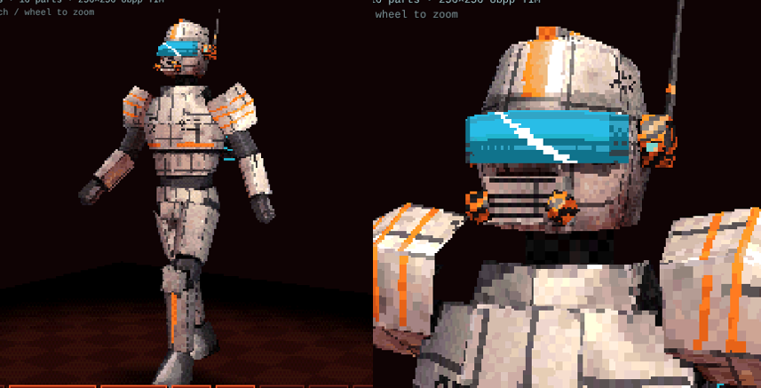
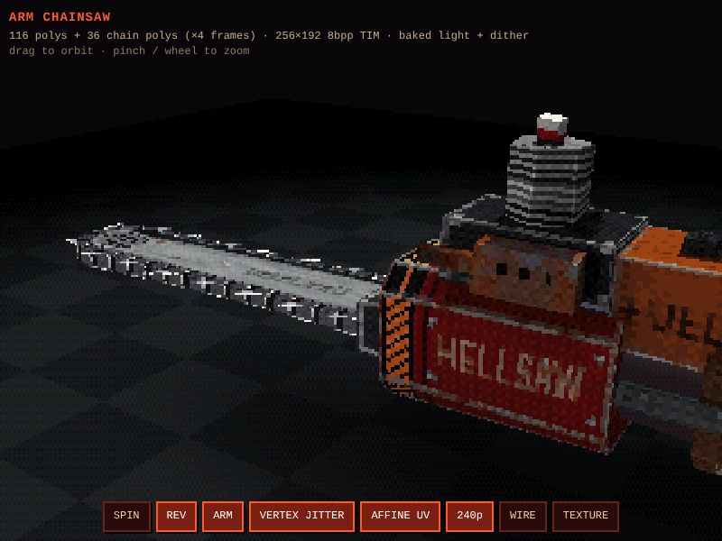

# Deadbird

A **third-person action game** built on a **true PS1-style engine**. You play Deadbird, a shinigami,
through the plant where her kind are drained for power. The engine is written so it can run on a
real PlayStation later. For now it ships on **Android** and **Windows PC** (with full Xbox
controller support), using a fast software model of the PS1's graphics chip.

## The game

- **Title**: hell sky, embers, DEADBIRD logo and menu (PLAY / EDITOR / CONTROLS) over the live
  level, with Deadbird roaming on autopilot.
- **Level editor** (EDITOR on the title; Windows and Android, not the PS1): an in-game editor for
  the same sector maps level 1 is made of, at the PS1's 320x240 and built for a gamepad first.
  See *Level editor* below.
- **Movement ported from Slayer from Hell** (`game/player.c`): Quake-style ground physics with
  friction, acceleration toward the stick direction, a stop speed, limited air control, gravity
  and jump. Floating analog stick on the left of the touch screen: half push walks, push past 70%
  (or hold R) runs. Directions are relative to where the camera looks now, so holding the stick
  to one side keeps her curving round as the camera follows. Walls slide you along them (she
  turns and walks along the wall); push straight into one and she just stops (no hit reaction). Ledges you step up are
  smoothed, and landings dip by how hard you hit.
- **Facing, lean and bank** (from Slayer's `Hero.java`): the body turns toward where she is
  actually moving, leans into acceleration (back when braking) and banks into turns.
- **Foot IK, as in Slayer from Hell** (`game/player.c`, two-bone solver in `engine/ik.c`): each
  foot stays planted on the ground while it is in stance and swings through on an arc (toe-off,
  heel strike, heel kick when running) on a gait clock driven by distance, so feet don't slide.
  Every foot finds the floor under itself, so on stairs each foot lands on its own step; the
  pelvis drops just enough for both legs to reach, and the knees bend forward to put the hooves
  on their targets. Turning on the spot makes little shuffle steps; jumping tucks the feet.
- **Keyframed upper body** (`game/fk.c`, clips in `game/fkclips.c`, authored by
  `tools/make_fkclips.py`): torso, head and arms play idle / walk / run clips in step with the
  legs, blended by speed, with air and landing poses on top.
- **Level 1: the Extraction Plant** - a Build-style **sector map** (`maps/e1.map`, compiled by
  `tools/make_map.py` into `gen/map_e1.c`, built at start-up by `gen/gen_lab.c`, drawn and
  collided by `game/level.c`; top-down plan in `docs/maps/e1.png`). Where they drain shinigami -
  what Deadbird is - for power. A hub level: the **Extraction Atrium** (a 14 m-tall octagon round
  the great extraction tank) with three keycard wings around it, played in key order:
  1. *Loading Dock* - a freight lift lowers her in from a shaft above the dock ceiling;
     a raised loading bay with steps; a secret panel in the west wall
  2. *Security Checkpoint* - a raised guard booth behind glass, steps down to the floor
  3. *Processing Floor* - 15 steps down off the atrium; extraction pods; the **cyan keycard**
  4. *Containment Block* (cyan door) - barred cells with captives under red light
  5. *Lab Ramp* and *Research Lab* - a sloped corridor up 3 m; the **amber keycard**; an
     overlook bay above the atrium you can jump down from (the way back)
  6. *Server Vault* and *Pipe Gallery* (amber door) - rack aisles, a long pipe-lined run north
  7. *Turbine Hall* - two turbines with spinning fans, a lift up to the catwalk 8 m up and the
     **crimson keycard**; a crimson door is the shortcut back into the atrium
  8. *Core Hall* and *Reactor Core* (crimson door) - a hall sloping down to a ledge, ramps down
     into the pit; walking up to the core plays the ending (she saws it open, the plant goes up),
     then a score screen: time, kills, secrets
  23 troopers, 3 keycards, 6 soul shards (+25 health, 3 of them in secret closets). The route
  test walks it end to end in key order: about 1 min running, 3.3 min walking - before fighting.
- **Sector maps** (like the Build engine): a map is a text file of sectors - floor
  plans with a floor and a ceiling height (either can slope). Two sectors sharing an edge make a
  portal: the builder draws the **lower wall** up to the next floor and the **upper wall** down
  from the next ceiling. Every wall part, floor and ceiling is cut into **2 m tiles, each with
  its own texture** (rows of tiles per wall, single-tile overrides, floor and ceiling rules on the
  world grid). Doors (locked to a keycard colour or not) slide up, lifts carry her between two
  heights; windows are thin sectors with glass or bars. `stairs` builds a flight of step sectors,
  `lightgrid` a field of lights, and props, lights, troopers and pickups are lines in the same
  file (a door is a sector whose ceiling rises like Doom's: its face rides up with it into the wall
above). Collision is per wall (a step taller than 22 cm or a gap too low blocks), the floor comes
  from the sector under her, and drawing floods from the camera's sector through the portals on
  screen (stopping at shut doors), like Build. `maps/test.map` is a small test map.
- **Textures with the detail painted in** (`gen/gen_labtex.c`, painted at start-up):
  80 procedural 64x64 tiles on five 4bpp pages, each tile with its own 16-colour CLUT, at a fixed
  **32 texels per metre** - one tile covers 2 x 2 m. Walls are built in 2 m bands: a base band
  (kickplates, painted pipes and valves, vents, hazard paint), a middle band (panels, posters,
  "AUTHORIZED PERSONNEL ONLY", **animated wall monitors**, room stencils like DOCK 07 / CHECKPOINT /
  REACTOR CORE 5, cell warnings, claw marks) and a top band (circuitry, I-beam + cable tray).
  Every doorway gets painted chevron jambs and an EXIT lintel. Each room has its own wall set;
  floors and ceilings have hazard lines, arrows, grates, drains, guide-light strips and painted
  cable trays. No floating decal polygons - details are part of the wall texture.
  Screens are painted tiles with a 2-frame animation strip (the game steps the texture
  coordinate along it every 12 frames): plant output graphs ("OUT 97% / 99%") and
  captive shinigami vitals (scrolling heartbeat, "SOUL 07% -> 06%", blinking CRITICAL).
  Every tile is chosen in the map: walls repeat their rows' patterns along the world's 2 m grid,
  and special tiles like screens are placed one by one. Desk consoles use bare-screen strips.
  Locked doors and keycards use tinted copies of the bulkhead and panel palettes. Baked
  bevels, grime and occlusion in the paint; PS1 4x4 ordered dither.
- **PS1-style level rendering**: about 9,000 textured polygons (1 m pieces near the floor, 2 m
  higher up) with **baked vertex lighting**: about 100 coloured lights, shadow rays against walls
  and solid props, ambient occlusion under props and along walls; the GPU gouraud-shades and
  dithers it. At run time: only the rooms seen through the portals on screen, chunk frustum
  culling, near-plane + guard-band polygon clipping, distance fog, pulsing screens / plasma /
  alarm lights, additive light halos, rising energy rings, spinning fans, sliding doors and lifts.
  Typically 360-980 level polygons on screen; the level (about 390 KB in RAM + 160 KB of VRAM
  textures) is generated in about 0.3 s at start-up. Tour: `docs/lab_tour.png`.
- **Camera**: third-person follow camera that drifts back behind you as you move; swing it with
  L1/R1 (< >) or by dragging a finger on the right side of the screen. Indoors it pulls in in
  front of walls, machines and the ceiling.

## Size

Almost nothing is stored: the game **builds itself at start-up** (about half a second on a PC).

- **Generated by code** (`gen/`): the whole level (from a 10 KB sector map: 9,000 polygons with
  the lighting bake), its 80 painted textures, and every sound effect and ambience loop.
- **Packed** (`assets/packed.h`, ~56 KB): what code can't paint - Deadbird's and the trooper's
  skins, the chainsaw and pistol, the touch UI, the font and the title painting - with a small
  JPEG-like codec and context-modelled meshes (`gen/pack.c`), re-quantised to 16-colour CLUTs
  with the PS1 dither as they load.
- **VRAM: 512 KB** instead of 1 MB, all textures 4bpp.
- **Windows** links no C runtime (`platform/windows/tinycrt.c`); **Android** ships arm64 only.
- **PS1**: the same generators run on the build machine (`tools/gen_dump.c`) and the results
  are linked in, because the PlayStation has no FPU to run them at boot.

## What "true PS1" means here

| PS1 hardware | Deadbird engine |
|---|---|
| MIPS R3000, **no floating point** | engine + game are pure fixed-point C (4096 = 1.0, angles 4096 = 360°) |
| **2 MB main RAM** | no `malloc`; all buffers are static, compile-time checked against a 2 MB budget (currently ~550 KB) |
| **1 MB VRAM** (1024×512, 16-bit) | the game uses only **512 KB** (512×512, map in `game/vram.h`): two framebuffers, every texture at 4bpp with a 16-colour CLUT per tile / skin / UI piece |
| GTE geometry coprocessor | `engine/gte.*`: `MATRIX`/`SVECTOR`, rotate-translate-perspective, `NCLIP` backface test |
| GPU + ordering tables | `engine/gpu.h`: primitives linked into a depth-sorted ordering table (OT), drawn far → near, no Z-buffer |
| GPU rasteriser | `engine/gpu_soft.c`: integer vertices (wobble), **affine** texturing, 4/8/15-bit textures, palette lookup, texel 0 = transparent, texture × colour / 128, 15-bit output, PS1 4×4 dither, 4 semi-transparency modes |
| textures | generated or unpacked at start-up and loaded straight into VRAM (`LoadImage`) |
| 320×240 display | double-buffered at VRAM (0,0)/(0,240); Android scales it up with nearest filtering, 4:3 letterbox |

A full game frame (level, player, HUD) takes **~1.3 ms** on a PC, so phones have lots of headroom.

## Layout

```
engine/            portable PS1 engine (C99, fixed point, no malloc)
  psx.h            types, PS1 memory constants, pad bits
  gte.[ch]         GTE-style matrix/vector maths + perspective
  gpu.h            primitives, ordering table, VRAM/GPU API
  gpu_soft.c       software PS1 GPU (Android/PC only; PS1 uses the real GPU)
  model.[ch]       rigid hierarchical models (one GTE matrix per body part)
game/              Deadbird itself (platform independent): flow, player movement + keyframed animation, level, HUD, fx, title;
                   the level editor: edmap.[ch] (the .map format in memory: parse, write, check,
                   compile, edit), editor.c (2D map, panels, level list), ed3d.c (3D view), edui.c
gen/               procedural assets: the sector-map builder + lighting bake (gen_lab.c), compiled
                   maps (map_*.c), level textures, sounds, 4-bit palettes, the image / mesh codec
maps/              the levels as text sector maps (e1.map = level 1, test.map for the tests)
assets/            packed.h (skins, meshes, UI, font, title painting, ~56 KB), mesh headers, src/ (their sources)
platform/android/  NativeActivity + GLES2 present + touch pad (Gradle project)
platform/windows/  Win32 + GDI present, XInput (Xbox controller) + keyboard
platform/psx/      real PS1 build (PSn00bSDK): GPU packet output, DualShock pad, CD image
platform/headless/ PC test build that renders frames to BMP (used by CI)
tools/             make_map.py (maps -> gen/map_*.c + docs/maps/*.png), pack_assets.py + packer.c
                   (assets/src -> packed.h), gen_dump.c (PS1 baking),
                   model builders (build_demon.py, ...) + import_authored.py, viewers
docs/PS1_PORT.md   notes on the PS1 build (PSn00bSDK)
```

## Controls

**Xbox controller (Windows)**: left stick move (push far to run) · right stick camera ·
**A** jump / confirm · **X** chainsaw (press again mid-swing to combo) · **B** dodge roll (hold to sprint out of it) · **RT** sprint · **LB / RB** swing camera · **START** pause ·
**BACK** quit to title from pause · D-pad / left stick for menus · rumbles on hard landings.
Any of the four controller slots, plugged in before or after starting.

**Keyboard (Windows)**: WASD / arrows move · SHIFT sprint · C dodge roll · SPACE jump · F, J, CTRL or left click chainsaw · Q / E camera ·
ENTER / ESC pause · F11 or ALT+ENTER fullscreen.

**PS1 / DualShock**: d-pad or left stick move · right stick camera · ✕ jump / confirm ·
□ chainsaw combo · ○ dodge roll · R2 sprint · L1 / R1 swing camera · START pause. Turn on analog mode (DualShock) in the
emulator for the sticks.

Running flat out for a second or so turns into a sprint on any device; throwing the stick the other
way at speed makes her plant her hooves and turn round. Rolling dodges laser bolts.

**Touch (Android)** - on-screen PS1 pad (the small chevron button above the chainsaw is the dodge roll):

- **D-pad**: move relative to the camera (menus: up/down; tap a menu row to pick it)
- **Left thumb**: floating analog stick (the demon eye; push far to run) · **right half**: swipe to turn the camera
- **Chainsaw** button: attack, tap again during a swing for the 3-hit combo (slash, backhand, overhead slam) · **wings** jump · **bones** (top right) pause

## Level editor

EDITOR on the title opens the level list: **NEW LEVEL**, **COPY OF LEVEL 1** (the Extraction Plant
as an editable copy - the real level 1 is never changed) and your saved levels (EDIT / PLAY /
DELETE). Levels are saved as `.map` files - the same format as `maps/e1.map`, so a level made in
the game can be dropped into `maps/` and built into the game with `tools/make_map.py`, and the
tools read it exactly as the editor does (`platform/headless/edtest` checks that level 1 compiles
byte for byte the same both ways). Where they're saved: next to `Deadbird.exe` in `levels\` on
Windows; `Android/data/<package>/files/levels` on Android (reachable over USB).

**2D map** - the map fills the screen; the top bar has the tool, the level's name and MENU / 3D /
UNDO / zoom buttons; the bottom bar shows what each button does right now (tap them on a touch
screen). The box top left says what's under the cursor.

| | Gamepad | Keyboard / mouse |
|---|---|---|
| move the cursor (snaps to the grid) | d-pad / left stick | arrows / the mouse |
| pan / zoom | right stick / L2 R2 | right drag / wheel, PGUP PGDN |
| use the tool | ✕ (A) | SPACE / click |
| cancel / back | ○ (B) | ESC |
| tools and things to place | △ (Y) | TAB |
| inspect and edit what's under the cursor | □ (X) | I |
| previous / next tool | L1 / R1 | Q / E |
| 3D view | SELECT (VIEW) | V |
| menu: save, play test, undo / redo, rename, grid, check | START (MENU) | M (CTRL+Z / Y, CTRL+S) |

Tools: **DRAW** (corner by corner; inside a room a convex shape is cut out of it as a new sector,
Build-style - a platform, a pit, a pillar), **RECTANGLE**, **EXTRUDE** (a new sector out from a
wall), **CUT** (split a sector along a line), **ADD CORNER**, **MOVE** (things, props, lights,
corners, walls or whole sectors - shared corners move together), **DELETE**, **JOIN** (two
sectors into one), **STAIRS** (a rectangle becomes steps climbing toward the side the cursor is
nearest, up to the next floor), **PLACE** (start, troopers, keycards, shards, secret shards, the
exit, lights, glows and every prop) and **TURN**. Walls that meet get their corners shared
automatically, and an edit that would break the map (crossing walls, overlaps) is undone with
the reason shown.

**Inspect** (□) opens a PS1-options-style panel - up / down picks a row, left / right changes it,
✕ opens it: a sector's name, room, kind (room / door / lift), floor and ceiling, door opening
height and keycard lock, lift heights, floor and ceiling slopes (pick the hinge wall, then the
height), floor and ceiling tiles and patterns, and its **wall / step / upper tile rows** (a rows
editor: rows bottom-up, tiles repeat along the wall, a pinned top row); a wall's own rows, glass,
bars, tile alignment and shadow; a thing's type, facing, key colour, secret flag and a trooper's
patrol point; a light's colour, height and radius; every prop's sizes, tiles and facing.

**3D view** (SELECT) - fly through the level as the game draws it and **paint single 2 m tiles**:
left stick / d-pad fly, right stick look (right drag with the mouse), L2 / R2 down / up, ✕ paint
the tile under the crosshair (or the mouse), □ pick up the tile you're looking at, L1 / R1 change
the tile, △ all textures, ○ back to the map. It paints walls (wall, step and upper parts, door
faces), floors and ceilings, one tile at a time (`wall I cell` / `fcell` lines in the file).

**PLAY TEST** (START menu) checks the map, builds it and drops you in; pause → ✕ goes back to the
editor. A gamepad works on Android too (Bluetooth / USB), and on Windows an Xbox controller.

## Building

**Android APK**: GitHub Actions builds it on every push (`Actions → build → Deadbird-debug-apk`).
To build locally: `gradle -p platform/android assembleDebug` with the Android SDK + NDK installed.

**Windows EXE**: GitHub Actions builds it on every push (`Actions → build → Deadbird-windows`,
a single `Deadbird.exe`, no installer or DLLs needed). To build yourself: MinGW-w64
(`make -C platform/windows`, natively in MSYS2 or cross-compiled from Linux) or Visual Studio
(`platform/windows/build_msvc.bat` from an x64 Native Tools prompt).

**PS1 disc image**: GitHub Actions builds it on every push (`Actions → build → Deadbird-ps1`).
It contains `deadbird.bin` + `deadbird.cue` (open the `.cue` in DuckStation, PCSX-Redux,
Mednafen, ePSXe etc.) and `deadbird.exe` (a PS-EXE you can load directly in PCSX-Redux or
send to a console with a loader). The disc has no Sony licence data, so it boots in emulators
(and on modded consoles) but not on a stock PS1. To build it yourself: install the
[PSn00bSDK](https://github.com/Lameguy64/PSn00bSDK) 0.24 release, set `PSN00BSDK_LIBS`, then
`cmake --preset default -S platform/psx && cmake --build platform/psx/build`.

**PC headless test**:
```
make -C platform/headless
./platform/headless/deadbird_headless out_dir   # scripted play-through: frames, timing, RAM use
make -C platform/headless gaittest && ./platform/headless/gaittest gait.bmp   # side-on walk/run sheet
```

## Combat

`game/combat.h` is one hit system for the player now and enemies later:

- **Targets**: anything hurtable registers a `CombatTarget` (feet position, radius, height, hit
  points, team, `on_hit` callback for its own reaction: damage, knockback, stagger, death).
- **Attacks**: a swing is an `Attack` capsule the attacker moves each frame while it's live.
  `attack_update` sweeps it from last frame's position (fast swings can't skip through things)
  and reports hits on other teams' targets (each once per swing) and on the level: walls, props
  and the floor, with the contact point and surface normal.
- **The chainsaw** is the first user: each combo swing has a live window; hitting steel throws
  sparks, screeches and kicks her back off the surface; the slam bites the floor; flesh (enemies)
  gets blood and the engine bogging down. Every hit freezes her for a few frames (hit-stop) and
  jolts the camera like a landing. `platform/headless/combattest` checks it all in CI.

## Assets

**Sci-fi trooper** (`tools/build_soldier.py`, ): the first enemy model,
box-modelled with the same pipeline as Deadbird and on her skeleton (same bone names, so her
animations drive him). 636 triangles, 507 vertices; off-white armour plates with panel seams,
bolts, chipped edges, grime and orange markings, a glowing wrap-around visor, rebreather, comms
pod and antenna, a power pack with coolant canisters, ribbed undersuit and rubber joints; baked
key/fill/rim light, ray-traced shadows and AO, PS1 dither into a 256-colour 8bpp TIM (VRAM
(768,256), CLUT row 494). `assets/soldier_mesh.h` + `soldier_tim.h` are ready; he isn't placed in
the level yet.

**Sound** (`tools/make_sounds.py`, previews in `docs/sfx/`): every sound is synthesised, no
recordings. Heavy hooves on steel grating, a booming landing, a jump whoosh, the chainsaw idling
and revving (pitch follows her speed), hellish menu chimes and a pause gong; ambience is a mains
hum, a throbbing reactor drone that swells near the great tank, steam bursts, distant clanks,
alarms and the moans of captive shinigami. Android (OpenSL ES), Windows (waveOut) and the
headless test mix 8-bit PCM in software (`engine/snd_mix.c`); the PS1 build plays the same sounds
as SPU ADPCM on the SPU's hardware voices (`platform/psx/snd_psx.c`).

**Title and UI** (`tools/make_title_bg.py`, `tools/make_ui.py`): the title screen is a painted
backdrop (`assets/src/title_bg.png`, 256 colours + PS1 dither) with forged menu plates; the touch
controls are a runic iron ring with a demon-eye stick, and horned bezels with wing / flame / claw /
bone icons that burn when pressed (atlas: `docs/ui_atlas.png`).

**Arm chainsaw** (`tools/build_chainsaw.py`, ): 116 polygons plus a
36-polygon chain, strapped to her right fist. One 256×192 8bpp texture holds everything, with
baked key/fill/rim lighting, shadow rays and ambient occlusion, painted details (hazard stripes,
stencils, rivets, cooling fins, spark plug lead, pull-start vents, leather straps, brushed bar,
nose sprocket) and PS1 dither. The chain is a 4-frame strip with transparent gaps between the
cutters; it idles slowly and revs when she runs. The script also writes a WebGL viewer page
(`tools/out/chainsaw_viewer.html`). Run it, then
`python3 tools/bin2c.py assets/chainsaw.tim chainsaw_tim > assets/chainsaw_tim.h`.

The skull demon is generated by `tools/build_demon.py`: box-modelled mesh, baked lighting,
PS1 dither and an 8bpp TIM. It writes `demon.tim` and `demon_mesh.h`. Then
`python3 tools/bin2c.py assets/demon.tim demon_tim > assets/demon_tim.h` embeds the texture.
