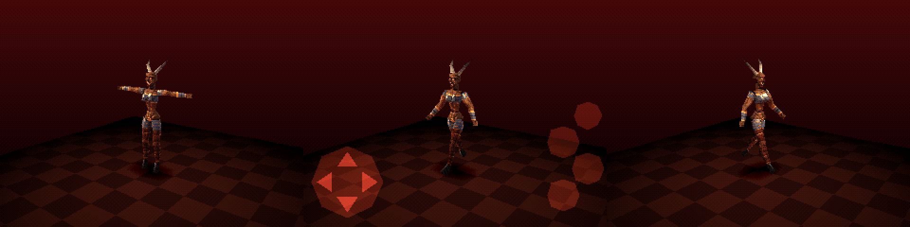

# Deadbird

A game built on a **true PS1-style engine**. The engine is written so it can run on a
real PlayStation later. For now it ships on **Android**, using a fast software model
of the PS1's graphics chip.



## What "true PS1" means here

| PS1 hardware | Deadbird engine |
|---|---|
| MIPS R3000, **no floating point** | engine + game are pure fixed-point C (4096 = 1.0, angles 4096 = 360°) |
| **2 MB main RAM** | no `malloc`; all buffers are static, compile-time checked against a 2 MB budget (currently ~320 KB) |
| **1 MB VRAM** (1024×512, 16-bit) | emulated 1 MB VRAM; framebuffers, textures and palettes (CLUTs) live in it exactly where a PS1 would put them |
| GTE geometry coprocessor | `engine/gte.*`: `MATRIX`/`SVECTOR`, rotate-translate-perspective, `NCLIP` backface test |
| GPU + ordering tables | `engine/gpu.h`: primitives linked into a depth-sorted ordering table (OT), drawn far → near, no Z-buffer |
| GPU rasteriser | `engine/gpu_soft.c`: integer vertices (wobble), **affine** texturing, 4/8/15-bit textures, palette lookup, texel 0 = transparent, texture × colour / 128, 15-bit output, PS1 4×4 dither, 4 semi-transparency modes |
| TIM textures | `engine/tim.*` loads `.tim` files straight into VRAM |
| 320×240 display | double-buffered at VRAM (0,0)/(0,240); Android scales it up with nearest filtering, 4:3 letterbox |

The software GPU draws a full frame in **~0.4 ms** on a PC, so phones have lots of headroom.

## Layout

```
engine/            portable PS1 engine (C99, fixed point, no malloc)
  psx.h            types, PS1 memory constants, pad bits
  gte.[ch]         GTE-style matrix/vector maths + perspective
  gpu.h            primitives, ordering table, VRAM/GPU API
  gpu_soft.c       software PS1 GPU (Android/PC only; PS1 uses the real GPU)
  tim.[ch]         TIM loader -> VRAM
  model.[ch]       rigid hierarchical models (one GTE matrix per body part)
game/              Deadbird itself (platform independent)
assets/            demon.tim (256x256 8bpp CLUT), demon_mesh.h (488 tris, 16 parts)
platform/android/  NativeActivity + GLES2 present + touch pad (Gradle project)
platform/headless/ PC test build that renders frames to BMP (used by CI)
tools/             asset generator (build_demon.py), viewer, bin2c
docs/PS1_PORT.md   plan for the real PS1 build (PSn00bSDK)
```

## Controls (test scene)

On-screen PS1 pad (Android) or pad buttons:

- **D-pad** left/right: orbit camera · up/down: zoom
- **✕** walk / stop · **○** auto-spin on/off · **△** reset camera · **START** hide/show touch pad
- **L1/R1** camera pitch

## Building

**Android APK**: GitHub Actions builds it on every push (`Actions → build → Deadbird-debug-apk`).
To build locally: `gradle -p platform/android assembleDebug` with the Android SDK + NDK installed.

**PC headless test**:
```
make -C platform/headless
./platform/headless/deadbird_headless out_dir   # writes frame_*.bmp, prints timing + RAM use
```

## Assets

The skull demon is generated by `tools/build_demon.py`: box-modelled mesh, baked lighting,
PS1 dither and an 8bpp TIM. It writes `demon.tim` and `demon_mesh.h`. Then
`python3 tools/bin2c.py assets/demon.tim demon_tim > assets/demon_tim.h` embeds the texture.
